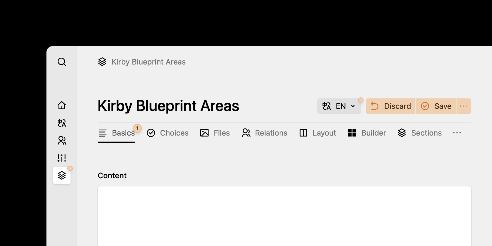

# Kirby Blueprint Areas

Add custom Panel areas via blueprints on Kirby CMS.



## Requirements

- Kirby 6
- PHP 8.3+

For Kirby 5, use version 3.x.

## Installation

```bash
composer require grommasdietz/kirby-blueprint-areas
```

> [!TIP]
> For a manual install, download the **Source code (zip)** archive of an immutable GitHub release tag and copy it to `site/plugins/kirby-blueprint-areas`.

## Quickstart

Create blueprints in `site/blueprints/areas`. Define `title`, `icon`, and your desired content:

```yml
# site/blueprints/areas/namespace.yml
title: Namespace
icon: box

tabs:
  content:
    label: Content
    columns:
      - width: 1/1
        sections:
          settings:
            type: fields
            fields:
              headline:
                label: Headline
                type: text
```

Each blueprint creates a Panel area. By default, it saves its fields on the site model. Use a [query](docs/usage/index.md#query) to select another model and [access rules](docs/usage/index.md#access-control) to restrict the area.

See the [options reference](docs/usage/index.md#options) for menu settings, model access and API configuration.

### Documentation

Full reference for [usage](docs/usage/index.md), [contributions](docs/contributions/index.md) and [maintenance](docs/maintenance/index.md) lives in [documentation](docs/index.md).

---

## Project information

- [Changelog](CHANGELOG.md)
- [Security policy and reporting](SECURITY.md)
- [Contributing](CONTRIBUTING.md)

---

## License

[MIT](LICENSE.md) © 2026 Grommas Dietz
